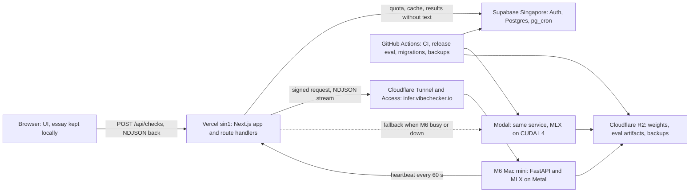
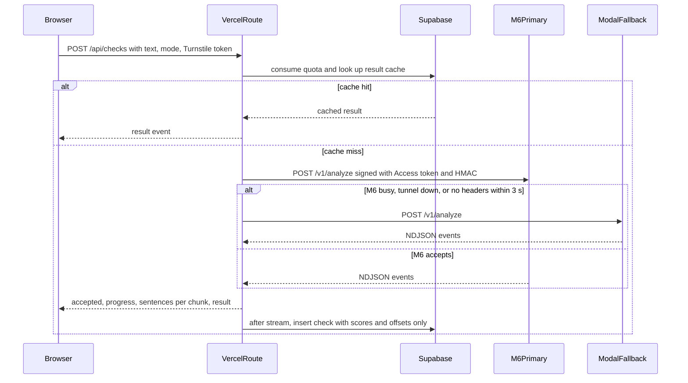
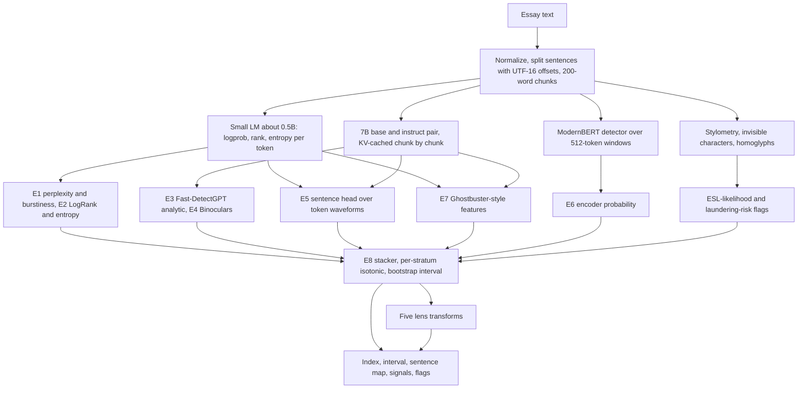

# VibeChecker master implementation plan

> For agentic workers: execute with superpowers:subagent-driven-development (recommended) or superpowers:executing-plans.
>
> - This master plan covers the whole product.
> - Each phase gets its own bite-sized TDD plan in `docs/plans/`, written at the start of that phase.
> - RFC-001 to RFC-012 are written to `docs/rfcs/` in Week 0.

**Goal:** Ship vibechecker.io, an explainable and calibrated AI-writing detector for Hong Kong university students (professors second).

- Private demo: about 6 Dec 2026.
- Public launch: 12-17 Jan 2027.
- Professor batch: Feb 2027.

**Architecture:**

- Next.js 16 on Vercel (region sin1) owns the UI, auth, quotas, caching and persistence in Supabase (Singapore).
- One Python inference service (FastAPI + MLX) runs natively on the M6 Mac mini behind a Cloudflare Tunnel.
- An identical copy on Modal (MLX on CUDA) is the automatic fallback.
- Results stream to the browser as NDJSON.
- Essay text stays in the browser unless a signed-in user opts in to encrypted saving.

**Tech stack:**

- TypeScript: Next.js >= 16.4.5, React 19, Tailwind 4, shadcn/ui (re-skinned), Motion, next-intl, zod, Vitest, Playwright, Biome.
- Python 3.12: uv, FastAPI, MLX >= 0.32.4, PyTorch (encoders), spaCy, scikit-learn, Ruff, pytest.
- Supabase: Auth, Postgres, pg_cron, pg_net, Vault.
- Cloudflare: Registrar, DNS, Tunnel, Access, Turnstile, R2, Email Routing.
- Also Modal, Resend, Sentry and GitHub Actions.
- Node 24 and pnpm 10.30.2, matching beat-ad.

**Global constraints (copied into every phase plan):**

- "A detector score is a reason to look closer, never proof." appears on every result screen and in the evidence kit.
- Every score ships with a confidence interval, a one-tap "why" and a one-tap "why detectors can be wrong".
- Kindly refuse essays under 150 words (Quick) or 300 words (Deep), and non-English essays.
- No third-party detector API is ever in the loop. Lenses are fitted only to published behavior and always carry the disclaimer.
- Essay text never appears in Postgres (except the opt-in encrypted copy), logs, Sentry, analytics or feature logs.
- Free tiers only until monetization. Vercel Hobby and the research-licensed training data are both non-commercial.
- WCAG AA throughout:
  - `prefers-reduced-motion` turns springs into fades of 150 ms or less.
  - The heatmap never relies on colour alone.
- Comments explain why, not what; ESM and strict TypeScript (beat-ad conventions).

## 1. Decisions locked in

- **Repo:** private `youwenshao/vibechecker` at `C:\Users\youwe\Projects\vibechecker` (branch `main`, no commits yet).
- **Money:** free product, no ads or payments. Stay on free tiers: Vercel Hobby, Supabase Free, Cloudflare Free, Modal Starter, Resend Free.
- **Audience and region:** Hong Kong students. Supabase `ap-southeast-1`, Vercel functions `sin1`. Privacy law: HK PDPO.
- **Compute:**
  - The M6 Mac mini runs both Quick and Deep mode: 32 GB, on home broadband, shared with beat-ad, `mac-mini-m6` on the tailnet.
  - Modal is the fallback and the eval compute.
- **Text storage:** browser-only by default. Signed-in users may opt in to encrypted saving, which expires with the result.
- **Access:** no account needed (Turnstile plus daily caps). Signing in adds history and higher caps.
- **Training data:**
  - Research-licensed datasets are fine while non-commercial.
  - A license-tagged registry and a commercial-only retrain come before any monetization.
  - No fresh corpus at launch.
- **Lenses:** named "Turnitin-style" and so on, with a disclaimer and no logos.
- **Language:** English essays only; UI in English and Traditional Chinese (zh-HK).
- **Defaults you can still overrule:**
  - Sign-in: magic link and Google.
  - Email: Resend for auth email; `hello@vibechecker.io` via Cloudflare Email Routing.
  - Monitoring: Sentry (no essay text) and Vercel Web Analytics.
  - Uploads: paste, .docx, .txt and .md at launch; PDF later.
  - Retention: results expire after 30 days; de-identified feature vectors are kept 12 months.
  - Daily caps per device: anonymous users get 10 Quick and 3 Deep checks; signed-in users get 30 and 10.

## 2. Where this plan deliberately departs from the spec

1. **Quick mode runs on the inference service, not in a Vercel function.** Serverless functions with 1-2 vCPUs can't run a 0.5B LM plus an encoder inside 2 s. The "Quick p95 <= 2 s" target is kept, measured end to end.
2. **Detection is compute-bound prefill, not generation.**
   - FLOPs are about 2 x params x tokens.
   - Deep mode is about 39 TFLOP per 1,000 words, which is single-digit seconds on the M6.
   - Memory is the binding constraint on a 32 GB shared box, hence 4- or 6-bit weights.
3. **MLX everywhere for language models**: Metal on the M6, CUDA on Modal, CPU in CI.
   - This replaces the spec's MLX plus llama.cpp split, giving one code path and near-identical numerics on primary and fallback.
   - A parity gate enforces this.
   - Encoders run in PyTorch fp32 (MPS, CUDA or CPU).
4. **Native launchd on the M6.** Docker on macOS has no Metal access, so the service runs under launchd. The container image is only for Modal and any Linux/CUDA box (the RTX 5090 workstation stays config-only).
5. **Binoculars needs a same-tokenizer pair**: base and instruct models from one family, not two families. Fast-DetectGPT uses its analytic form (no sampling), computed from the same two forward passes.
6. **Deep mode prefills each model chunk by chunk with a KV cache.**
   - This is identical to one full pass, with no overlap compute.
   - Scores don't depend on how the text is chunked.
   - Each ~200-word chunk's sentences stream as soon as both models finish it.
7. **Progress streams directly** instead of through a queue and Supabase Realtime: the Vercel route proxies the inference NDJSON.
   - Essay text therefore never enters Postgres, its WAL or its backups.
   - Supabase Queues and Realtime arrive with the Phase 3 professor batch.
   - Cloudflare Queues are not used.
8. `**roberta-large-openai-detector` is a harness baseline only.** It dates from the GPT-2 era.
9. **The headline is an index, not a raw probability.** A calibrated probability depends on the base rate, so we show a "Robot-smell index" calibrated at a 50% prior, plus a base-rate explainer on the methodology page.
10. **Anonymous caps are per device, not per IP.** IP-only caps would lock out whole campuses behind NAT. A generous per-IP ceiling still stops scripted abuse.

## 3. Architecture





**Router** ([apps/web/lib/inference/router.ts](apps/web/lib/inference/router.ts)):

- Skips the M6 if its heartbeat is older than 3 minutes.
- Otherwise calls `https://infer.vibechecker.io/v1/analyze`.
- Falls back to Modal on 503 busy, any edge 5xx (tunnel down), or no response headers within 3 s.
- A stream that breaks mid-way ends with a retryable error; the client retries once and lands on the fallback.

**M6 authentication:**

- A Cloudflare Access service token at the edge.
- An HMAC-SHA256 signature checked in FastAPI, covering the timestamp, request ID and body hash, with a 60 s window and a replay cache.
- Modal checks the same HMAC.

**Heartbeat:**

- The M6 posts to `/api/engine/heartbeat` every 60 s, and Vercel writes `engine_status`.
- This also stops Supabase Free from pausing the project.
- pg_cron emails you through Resend if the heartbeat is stale for 10 minutes.

**Streaming contract** ([packages/contracts/src/inference.ts](packages/contracts/src/inference.ts)):

- zod is the source of truth.
- It is exported to JSON Schema and generated into pydantic models.
- A CI drift check keeps the two in sync.

```ts
export const InferenceEvent = z.discriminatedUnion("type", [
  z.object({ type: z.literal("accepted"), backend: z.enum(["mlx-metal", "mlx-cuda", "mlx-cpu"]), engineVersion: z.string(), chunks: z.number().int() }),
  z.object({ type: z.literal("progress"), stage: z.string(), done: z.number().int(), total: z.number().int() }),
  z.object({ type: z.literal("sentences"), items: z.array(SentenceScore) }), // UTF-16 offsets into the exact submitted string
  z.object({ type: z.literal("result"), result: CheckResult }),
  z.object({ type: z.literal("error"), code: z.enum(["too_short", "not_english", "busy", "internal"]), retryable: z.boolean() }),
]);
```

## 4. Repository layout and module boundaries

```
apps/web/            Next.js app: pages, route handlers, components, messages/{en,zh-HK}.json, proxy.ts
packages/contracts/  zod schemas -> JSON Schema -> generated pydantic (drift-checked)
engine/              vibechecker_engine: text prep, MLX/PyTorch backends, signals, stacker, calibration, lenses
services/inference/  vibechecker_inference: FastAPI app, scheduler and backpressure, HMAC, heartbeat
eval/                vibechecker_eval: dataset registry, feature runners, metrics, reports, lens fitting
modal/               fallback app and eval jobs, built from the same engine package
supabase/            config.toml, migrations/, tests/ (pgTAP)
ops/m6/              launchd plists, install and deploy scripts, cloudflared config
docs/                rfcs/, plans/, design/DESIGN.md
.github/workflows/   ci, eval-release, migrate, deploy-modal, backup, export-features
```

**Root files:**

- [AGENTS.md](AGENTS.md)
- [package.json](package.json): the pnpm workspace.
- [pyproject.toml](pyproject.toml): the uv workspace (engine, services/inference, eval, modal).

**Boundaries:**

- The web app knows only the contracts package and HTTP.
- The service only orchestrates; all detection math lives in `engine/`.
- `eval/` imports `engine/`, never the reverse.
- Lens parameters are data (`engine/lenses/*.yaml`), not code.

## 5. Detection engine



Quick mode runs the small LM, encoder and stylometry branches with its own stacker. Deep mode runs everything.

**Per-signal cost for a 1,000-word essay** (about 1,300 tokens). M6 figures are scaled from Apple's published MLX prefill results on the M5 and will be measured on the real machine in Week 0.

- **E1 perplexity and burstiness, E2 LogRank and entropy:** small LM (~0.5B), one pass, ~1.3 TFLOP. M6 0.1-0.3 s; Modal L4 under 0.1 s.
- **E6 encoder:** ModernBERT detector (~150M parameters), ~0.4 TFLOP. M6 0.1-0.3 s; L4 under 0.1 s.
- **Stylometry, ESL-likelihood, laundering risk, invisible characters and homoglyphs:** CPU, 0.1-0.2 s.
- **E3 Fast-DetectGPT (analytic) and E4 Binoculars:** 7B base plus 7B instruct, one pass each, ~39 TFLOP. M6 3-6 s; L4 1-2 s when warm.
- **E5 and E7:** a small CNN/attention sentence head over token waveforms, and a Ghostbuster-style classifier. Both reuse the cached token features; under 0.1 s.
- **E8:** stacker, calibration and bootstrap interval, under 0.05 s.
- **Totals:**
  - Quick: about 0.5 s on the M6 (target p95 <= 2 s end to end).
  - Deep: about 4-8 s per 1,000 words (target p95 <= 25 s at 2,000 words).
  - A Modal cold start adds 15-40 s.

**Model candidates.** The harness bake-off picks the best essay-domain TPR@1%FPR and ESL false-positive rate within the memory cap.

- Small LM: Qwen2.5-0.5B. Alternatives: Qwen3-0.6B-Base, SmolLM2-360M, GPT-2.
- Pair: Falcon-7B plus Falcon-7B-Instruct, the Binoculars paper baseline (we reproduce its published numbers first). Alternatives: Qwen2.5-7B plus Instruct, Qwen3-8B-Base plus Qwen3-8B.
- Encoder: `GeorgeDrayson/modernbert-ai-detection-raid-mage`. An essay-domain fine-tune only if the harness shows lift.
- All candidates are Apache-2.0 or MIT. Models with no license or non-commercial-only weights are excluded.

**Memory per hardware tier:**

- **Footprints:**
  - The 7B pair is ~8.5 GB at 4-bit, ~11.5 GB at 6-bit, ~15 GB at 8-bit and ~29 GB at bf16.
  - The Quick stack is ~1.5 GB; the KV cache and chunked vocabulary buffers add ~1-2 GB.
- **M6** (32 GB, shared with macOS and beat-ad):
  - VibeChecker is capped at 18 GB via `mx.set_memory_limit`.
  - A memory-pressure guard returns 503 busy.
  - That cap means the 4- or 6-bit pair, ~11-15 GB in total.
- **Modal L4 (24 GB):** the same weights and quantization as the M6, so scores match.
- **Modal L40S (48 GB):** bf16 reference runs for bake-offs and release evals only.
- **GitHub CI (CPU):** `mlx[cpu]` with the SmolLM2-135M base and instruct pair as a plumbing fixture.

**Backend interface** ([engine/src/vibechecker_engine/backends/base.py](engine/src/vibechecker_engine/backends/base.py)):

- Binoculars and Fast-DetectGPT are closed-form functions of `PairStats`, using each paper's role assignment.
- Both are golden-tested against the official reference code.

```python
class PairStats(NamedTuple):
    logp_a: np.ndarray    # [T] log p_A(x_t)
    cross: np.ndarray     # [T] sum_v p_B(v) * log p_A(v)
    cross_sq: np.ndarray  # [T] sum_v p_B(v) * log p_A(v) ** 2

class LMBackend(Protocol):
    name: Literal["mlx-metal", "mlx-cuda", "mlx-cpu"]
    def token_stats(self, model: str, ids: Sequence[int], cache: KVCache | None) -> TokenStats: ...
    def pair_stats(self, a: str, b: str, ids: Sequence[int], caches: PairCaches | None) -> PairStats: ...
```

**Parity gate:** on 200 fixture essays, Metal and CUDA must agree within 1 index point overall and 0.02 per sentence, or the release is blocked.

**Result cache:** keyed by HMAC(normalized text) plus mode plus engine_version, so an identical re-check returns an identical result on any backend.

## 6. Calibration, evaluation harness and lenses

**Dataset registry** ([eval/registry.yaml](eval/registry.yaml)):

- Every entry records source, version, sha256, license, `commercial_ok`, `share_alike`, splits and strata.
- Every training entry point takes a `--commercial-only` flag; this is the monetization switch.

Datasets:

- **RAID** (train and eval): many generators and domains, plus 11 adversarial attacks. License to verify.
- **MAGE** (train and eval): adds argumentative and other domains. License to verify.
- **PADBen** (eval, and the laundering flag): availability and license to verify.
- **Liang et al. TOEFL set** (eval only): the published ESL false-positive stratum.
- **PERSUADE 2.0 and ELLIPSE:** human student essays with English-language-learner labels. CC BY-NC-SA 4.0, so research only and share-alike.
- **ASAP 2.0 and a public AI-essay set** (e.g. Kaggle DAIGT): essay-domain coverage and spliced mixed documents. Licenses to verify.

**Metrics** are computed per split and per stratum. Strata:

- Length bins: 150-299, 300-599, 600-1,199 and 1,200+ words.
- Essay vs other genres.
- ESL vs native writers.
- Attack type and generator family.

Reported metrics:

- AUROC, TPR@1%FPR, ECE and Brier score.
- False-positive rate at each band threshold, and sentence-level F1.
- Per-backend latency (p50 and p95), and Metal vs CUDA deltas.

Reports go to `eval/reports/<engine_version>/report.{json,md}`; the JSON feeds the methodology page.

**Proposed launch gates**, frozen in RFC-004 after the first baseline run:

- Deep essay AUROC >= 0.90; Quick >= 0.85.
- ECE <= 0.05 pooled and <= 0.08 per stratum.
- Human-essay false-positive rate at the top band <= 2%.
- ESL/TOEFL false-positive rate <= 5%, with a gap to native writers of <= 3 points (Wilson intervals published).
- No metric worse than the previous release by more than 0.01.

**Calibration:**

- **Stacker:** scikit-learn HistGradientBoosting over length-weighted, document-level signal aggregates. Monotonic constraints where the direction is known.
- **Calibrator:** isotonic, per stratum where n >= 1,000 (pooled otherwise), at a 50/50 prior.
- **Interval:** the 5th-95th percentile across 200 bootstrap calibrators, with a minimum width per length bin.
- **Display:** "Robot-smell index 62 (likely 48-75)". Band thresholds are chosen so each band meets the false-positive gates.

**Lenses:**

- Each lens is a monotone transform of our calibrated signals, stored in versioned YAML.
- `vibechecker_eval fit-lenses` fits them to published operating points only.
- Validation passes when the achieved false-positive rate is within 2 points of the published figure.
- Every chip carries: "An approximation of publicly described behavior. The real {Vendor} model is proprietary; not affiliated or endorsed."
- Sources are listed on the methodology page.

The five lenses:

- **Turnitin-style:**
  - Sentence scores are thresholded to about a 4% sentence-level false-positive rate.
  - It shows "% of text likely AI", and 1-19% displays as "*%".
  - Footnote: mixed documents are its weak spot.
- **GPTZero-style:**
  - Weighted toward perplexity and burstiness.
  - A conservative threshold: about 1-2% false positives on ESL essays (vendor claim).
  - Shows a human / mixed / AI view.
- **ZeroGPT-style:** a deliberately loose threshold, about 20% false positives on human essays (independent tests). Footnote: flags about 1 in 5 human essays.
- **Grammarly-style:** encoder plus polish features. Footnote: polished human writing trips it.
- **VeriGuide-style:**
  - Template-phrase overlap plus the encoder.
  - Shows only low, medium or high.
  - Marked lowest confidence, since there is little public detail.

## 7. Data model, privacy and security

**Tables.** All have RLS, and writes come only from server code using the secret key.

- `**profiles`.**
- `**checks`:**
  - Nullable `user_id`, `claim_token_hash`, mode, engine_version, backend, word_count.
  - `result` jsonb: index, CI, signals, lenses, flags, and sentence offsets with no text.
  - `expires_at` at 30 days.
- `**private.check_texts`:**
  - Opt-in AES-256-GCM ciphertext.
  - Each row has its own key, wrapped by `ESSAY_KEK`, which lives only in Vercel env.
- `**result_cache`.**
- `**feature_log`:** no user ID and no text. Exported nightly to R2 as Parquet and pruned from Postgres after 7 days.
- `**quota_usage`.**
- `**engine_status`.**
- **Phase 3:** `batches` and `batch_items`.

```sql
create policy "owners read their checks" on public.checks
  for select to authenticated using (user_id = (select auth.uid()));
create policy "owners delete their checks" on public.checks
  for delete to authenticated using (user_id = (select auth.uid()));
revoke execute on function public.consume_quota(text, text, int) from public, anon, authenticated;
grant execute on function public.consume_quota(text, text, int) to service_role;
```

**Anonymous results:**

- The browser keeps a claim token and the essay text in IndexedDB for 30 days, with a "forget on this device" button.
- Signing in claims earlier checks.
- No Supabase anonymous users are needed.

**Retention**, enforced by pg_cron and shown in the UI:

- Checks and saved texts: 30 days.
- Result cache: 30 days.
- Quota rows: 7 days.
- Feature log: 7 days in Postgres, then 12 months in R2.
- Encrypted nightly backups: 14 days.

**Deletion:** one check, all checks, or the whole account (cascades).

**Logging:**

- Request bodies are never logged anywhere: not in Vercel, FastAPI or Modal.
- Sentry's `beforeSend` strips request bodies.

**Auth:**

- `@supabase/ssr`.
- [apps/web/proxy.ts](apps/web/proxy.ts) refreshes sessions with `getClaims()` and handles locale routing.
- pgTAP tests cover every policy.

**Abuse:**

- Turnstile on anonymous checks and on auth.
- Device caps plus a per-IP ceiling of about 300 Quick and 60 Deep checks a day.
- Input limits: Quick up to 5,000 words, Deep up to 2,500.
- No public API; the Terms ban automated accusation pipelines.
- Modal workspace budget cap of $30.

## 8. Week 0 setup checklist

Items marked [You] need your login, payment, sudo or a click. Everything else I do with the CLIs and MCP tools.

**GitHub:**

- [You] Run `gh auth refresh -h github.com -s workflow`.
- I create the private repo, push the skeleton and add Actions secrets.
- Branch protection on a private repo needs GitHub Pro; without it, "CI green before merge" is a convention.

**Cloudflare** (the Access org and R2 already exist):

- Turn on auto-renew for vibechecker.io (it expires 2027-11-20).
- Vercel apex and `www` records, DNS-only.
- A Turnstile widget.
- R2 buckets `vibechecker-artifacts` and `vibechecker-backups`, with scoped tokens.
- Tunnel `vibechecker-m6` routed to `infer.vibechecker.io`, plus an Access app with a service-token policy.
- Email Routing from `hello@` to your Gmail. [You] Click the verification email.
- A DMARC record at `p=none`.

**Supabase:**

- Create `vibechecker-prod` and `vibechecker-staging` (Free, ap-southeast-1). This uses both free project slots, and staging may pause when idle.
- Migrations, auth URLs (including Vercel preview wildcards), pg_cron, pg_net, Vault and Turnstile captcha.
- Custom SMTP via Resend, with bilingual email templates.

**Google sign-in:** [You] Create a Google Cloud OAuth web client (basic scopes, consent screen named VibeChecker) and give me the client ID and secret.

**Resend:**

- [You] Sign up and create an API key.
- I add the DKIM, SPF and MX records for `send.vibechecker.io` and verify the domain.

**Vercel:**

- [You] Approve the connector link I generate, or run `vercel login` once.
- I create the project from the repo: root `apps/web`, Node 24, region `sin1`.
- Production env points at prod Supabase; Preview and Development point at staging.
- Domains and Web Analytics.

**Modal:**

- [You] Sign up, add a payment method and run `modal token new`.
- I set the $30 budget cap, secrets and the weights Volume, then deploy the fallback app.
- Operator decision, 20 Nov 2026. The workspace currently has a $1 monthly cap. Keep hosted Modal GPU inference, evaluation and the live failover drill on hold until the operator lifts the hold after adding a payment method. Use the M6 for staging checks and evaluation during this period.

**Sentry** (can wait until Phase 2): [You] Sign up. I create the project and DSN and set the scrubbing rules.

**M6:**

- M6 operator setup:
  - Use the existing `youwenshao` macOS account over Tailscale SSH (operator decision, 20 Nov 2026). The existing tailnet policy permits this principal. Deploy into its dedicated `~/vibechecker` directory and run inference as `youwenshao` under launchd.
  - Confirm `pmset autorestart 1` and `sleep 0`, at least 60 GB of free disk, and the macOS version.
  - Install a separate user LaunchAgent, `io.vibechecker.cloudflared`, for the VibeChecker tunnel.
  - Don't use `cloudflared service install`: it would overwrite the beat-ad tunnel's service.
- Then I:
  - Install uv and Python 3.12, and pull the weights from R2.
  - Install the `io.vibechecker.inference` LaunchAgent with KeepAlive in the same login session.
  - Verify that MLX can use Metal under launchd.
- Deploys go through [ops/m6/deploy.sh](ops/m6/deploy.sh) over Tailscale SSH. The operator sends an archive of the selected Git revision to the dedicated release directory.
- Power-loss recovery with FileVault reuses beat-ad's procedure. After reboot, signing in as `youwenshao` starts the two LaunchAgents.

**Done when:**

- `vibechecker.io` serves a placeholder over HTTPS.
- `infer.vibechecker.io/v1/health` returns 403 without a token and 200 with the token and HMAC.
- Modal's health check returns 200.
- Migrations are applied to both Supabase projects.
- A magic-link email arrives with SPF and DKIM passing, and `hello@` forwards.
- CI is green.

## 9. Cost model

Assumptions:

- Each user runs 2 checks a week; 15% are Deep; essays average about 1,000 words.
- The M6 serves about 97% of checks.
- One Modal release eval a month.
- Free-tier limits as of Nov 2026.

Monthly cost by scale:

- **500 MAU** (about 4,300 checks, 650 of them Deep):
  - Everything is $0 except the domain (~$5 a month amortized) and M6 power (<= $1).
  - Modal uses about $5-10 of its $30 monthly credit.
  - Total about $6 a month, against the spec's < $50 target.
- **1,000 MAU** (about 8,700 checks): about $6 a month; Modal uses about $8-15 of credit.
- **3,000 MAU** (about 26,000 checks): about $6-36 a month.
  - Resend's 100-emails-a-day cap may force its Pro plan (+$20), and Modal may slightly exceed the credit.
  - If Supabase or Vercel limits force paid plans (+$45), it becomes about $51-81.

**Electricity:**

- The M6 already runs 24/7 for beat-ad.
- VibeChecker adds roughly 2-10 active hours a month, under $0.10.
- Even charging VibeChecker for the M6's whole idle draw (~4-5 kWh at ~US$0.18/kWh) stays under $1.

**Breakeven, local vs serverless:**

- Serverless-only (every check on a Modal L4, with scale-down idle time billed):
  - About $40-80 a month at 500 MAU and $150+ at 3,000.
  - Plus 15-40 s cold starts.
- The M6 is already owned, so it breaks even immediately.
- A new ~$1,000 mini would pay for itself in about 1-2 years at 500 MAU, and in under a year at 3,000.

**Upgrade triggers** (RFC-012), any one of:

- Supabase database over 400 MB, or egress over 4 GB a month.
- Vercel usage warnings.
- The Resend daily cap hit twice in a week.
- 80% of the Modal credit used before the 20th of the month.
- Any monetization.

## 10. UX and design direction

**Inspo exemplar:** [ecolevision.com](https://ecolevision.com).

- What we take from it:
  - A "Marquee Hero" layout on a cream canvas.
  - Display type about 4x the body size.
  - Pill shapes, and one signature glyph moment.
- We follow its macrostructure and ratios, not its tokens.
- The hero fits the first viewport (1280x800, 100svh): a two-line H1, a subline, then the paste box as the hero object.
- Sections sit 96-140 px apart in a 1,200 px column.

**Signature moment:** the "o" in "robot" in the H1 is a tiny chartreuse gauge dial whose needle settles once.

**Mobbin patterns borrowed:**

- [Codecademy benchmark score](https://mobbin.com/screens/fc2dd380-28af-4459-95ba-a21396c65286?utm_source=cursor&utm_medium=ai-assistant&utm_source_platform=mcp): a gauge with labelled bands and an "About this score" link. Used for the verdict gauge.
- [Hume AI text editor](https://mobbin.com/screens/f630a5bc-7630-42c8-a756-cd2669012654?utm_source=cursor&utm_medium=ai-assistant&utm_source_platform=mcp): a text pane with a "Highlight predictions" side panel. Used for the heatmap and its signal filter.
- [Grammarly editor with AI-check tab](https://mobbin.com/screens/fc8dd542-c0cf-47de-86db-ed9f9e5e190c?utm_source=cursor&utm_medium=ai-assistant&utm_source_platform=mcp): a document with a right-hand panel. Used for the results layout.
- [ElevenLabs editor](https://mobbin.com/screens/fe8dcb43-f770-4ade-894d-0e187d80b874?utm_source=cursor&utm_medium=ai-assistant&utm_source_platform=mcp): inline tags in the text and a footer counter. Used for signal chips and the live word-count gate.

**21st.dev components:**

- `danielpetho/text-highlighter`: adapted for the heatmap sweep, with one `get_component` call at implementation. Re-skinned, with a reduced-motion path.
- `aadilghani1/usage-meter`: reference only, for the quota meter.

**Tokens** ([apps/web/app/globals.css](apps/web/app/globals.css), Tailwind 4 `@theme`):

- Paper `#FAF8F4`, ink `#171512`, panel `#E9E6F2`.
- The accent is chartreuse `#D8FF3E`, used only as a fill under ink text (about 17:1 contrast), never as text on paper.
- Heat steps `#F3F8D2`, `#E9FB98` and `#D8FF3E`, plus a 1/2/3 px underline weight as the non-colour cue.
- Radius 24 px for cards; pills fully rounded.

**Type:**

- Display: Clash Display 600-700, self-hosted (ITF Free Font License), 56-112 px, line height 1.0.
- Body: Instrument Sans, 16-18 px.
- Numbers: JetBrains Mono with tabular figures, everywhere.
- zh-HK: Noto Sans HK, subset for the PDF.

**Components:**

- **Input:**
  - PasteBox: paste, .docx via mammoth, .txt/.md, and a live word count with the 150/300 gate.
  - ModeToggle, QuotaMeter, StatusTicker.
- **Verdict:**
  - VerdictGauge, with a CI arc and band label.
  - WhyPanel and WrongPanel, the two one-tap sheets.
  - SignalCards: plain name, analogy, value vs the human reference, and a sparkline.
- **SentenceHeatmap:**
  - A tooltip naming the signals that fired.
  - Keyboard navigation, a list-view fallback and a signal filter.
- **Context and output:**
  - FlagBanner (ESL, laundering, invisible characters).
  - LensPanel (chips, a spread dot plot, footnotes).
  - AdvicePanel.
  - EvidenceKit: a one-page PDF built in the browser with `@react-pdf/renderer`.
- **Chrome and pages:**
  - EngineBanner, HistoryList, PrivacyControls, LocaleSwitcher.
  - MethodologyCharts: reliability diagram, false-positive bars per stratum, base-rate explainer.
- **Phase 3:** BatchUploader, BatchTable, RationaleCard.

**Motion** (Motion for React, with `MotionConfig reducedMotion="user"`):

- **Default spring:** stiffness 170, damping 22. One soft overshoot; settles in about 450 ms.
- **Gauge:** the needle uses damping 20, and the number counts up in sync. The CI arc grows after the needle settles.
- **Heatmap:** sentences sweep in reading order with a 30 ms stagger as chunks arrive.
- **Cards and chips:** rise 8 px with a 40-60 ms stagger.
- **Buttons:** scale to 0.96 on press.
- **Status lines:** swap about every 1.6 s.
- **Reduced motion:** 150 ms fades; the gauge jumps straight to its value; no cascades; a static status line.

**Voice**, one example per state. All copy lives in [apps/web/messages/en.json](apps/web/messages/en.json); I draft the zh-HK copy and you review it.

- **Hero:** "Does your essay smell like a robot? Paste it in. We'll show you what detectors notice, and why they're often wrong."
- **Short text:** "That's 112 words. We need 150 for a Quick check (300 for Deep) to say anything honest. Below that, every detector is guessing; we'd rather not."
- **Not English:** "We only read English essays for now. Anything else and our robots start making things up."
- **Loading:**
  - "Asking two robots to gossip about your essay..."
  - "Measuring how predictable each sentence is..."
  - "Looking for suspiciously tidy transitions..."
- **Low score:** "Suspiciously human. Nice work." Then: "Robot-smell index 12 (likely 6-21). Short or very polished passages can still trip detectors; here's where."
- **Mixed score:** "Mixed signals. Some parts read human, some read machine-smooth. Here's which is which."
- **High score:** "This reads a lot like AI text. That's a reason to look closer, not proof. Here's exactly why, and what to do if you wrote it yourself."
- **ESL flag:** "Heads up: your writing has patterns common in English as a second language. Detectors, ours included, over-flag these. We calibrate for it, but keep your drafts handy."
- **Lens spread:** "Five detectors, five opinions. Here's roughly how each would grade this. They disagree a lot, which is kind of the point."
- **Fallback:** "Our home robot is napping, so a cloud robot is covering. Same brain, slower first try."
- **Rate limit:** "That's today's free Deep checks. Robots need sleep too. Back tomorrow, or sign in for more."
- **Error:** "Something broke on our side, not yours. Nothing was saved. Try again?"
- **Footer:** "A detector score is a reason to look closer, never proof. Ours included."

**Accessibility:**

- A unit test checks the contrast of every token pair.
- Playwright with axe on home, results, history and methodology.
- A keyboard path through the heatmap.
- A reduced-motion run using `emulateMedia({ reducedMotion: "reduce" })`.

## 11. Build sequence

**Cut order if we slip** (protects the launch date):

1. Grammarly-style and VeriGuide-style lenses.
2. .docx upload.
3. The zh-HK long-form methodology page (UI strings stay).
4. The Ghostbuster-style signal.
5. Google sign-in (magic link stays).

**Week 0 (21-23 Nov): repo, infra, RFCs**

- W0.1 Skeleton: workspaces, AGENTS.md, Biome, Ruff, and CI on Ubuntu (path filters, within GitHub's 2,000 private-repo minutes). Verify with `pnpm verify` and `uv run pytest`.
- W0.2 Contracts package with schema export, pydantic generation and the drift check.
- W0.3 RFC-001 to RFC-012 in [docs/rfcs/](docs/rfcs/).
- W0.4 Work through the Section 8 checklist, ending with a placeholder deploy and the tunnel health check.
- W0.5 M6 spike: run MLX on Metal under launchd and measure prefill throughput (0.5B, and 7B at 4-bit, over 1,300 tokens). Record the results in RFC-003.

**Phase 0 (24 Nov-6 Dec): eval harness, Quick mode, paste UI.** Demo: Quick checks on staging served by the M6, with automatic failover to Modal.

- 0.1 Dataset registry, loaders, sha256 manifest and R2 sync; a license verification report.
- 0.2 Text prep:
  - Normalization; spaCy sentence splitting with UTF-16 offsets.
  - Language ID (lingua); invisible-character and homoglyph detection.
  - Property tests for emoji, CJK and smart quotes.
- 0.3 MLX backend `token_stats` with KV-cached chunking; a CPU vs Metal parity test; a golden test against a PyTorch reference.
- 0.4 Quick signals E1, E2, E6 and stylometry, plus a latency benchmark on the M6.
- 0.5 Harness runner (on Modal and the M6), metrics and reports. Commit the first baseline.
- 0.6 Quick stacker, calibration, interval, bands and the minimum-length refusal. Apply the gates to the report.
- 0.7 Inference service:
  - NDJSON `/v1/analyze`, `/v1/health` and HMAC checks.
  - A scheduler with 1 Deep and 4 Quick slots that waits 2-5 s before returning 503.
  - The memory guard and the heartbeat.
  - Contract tests, then deploy to the M6.
- 0.8 Modal fallback app and the web router, with failover tests for primary down, busy and hung.
- 0.9 Web v0:
  - DESIGN.md, tokens, fonts and the i18n skeleton.
  - Home page with PasteBox.
  - Results v0: gauge, CI, band, Why/Wrong panels, signal cards.
  - `/api/checks`: Turnstile, quota, cache, router and stream, then persistence via `after()`.
  - IndexedDB text storage and claim tokens.
- 0.10 Playwright smoke tests against a mock inference server, including axe and reduced motion.

**Phase 1 (7-20 Dec): Deep mode and heatmap.** Demo: a Deep check whose heatmap streams in chunk by chunk.

- 1.1 `pair_stats`, Binoculars and analytic Fast-DetectGPT, golden-tested against the official implementations.
- 1.2 Reproduce the published Falcon-pair AUROC on a reference subset (bf16 on an L40S).
- 1.3 Bake-off of the pairs at 4-, 6- and 8-bit against bf16. Choose within the 18 GB cap; Metal vs CUDA parity gate.
- 1.4 E5 sentence head: a spliced mixed-document builder, training on Modal, and sentence-level metrics.
- 1.5 E7 Ghostbuster-style features and classifier.
- 1.6 ESL-likelihood and laundering-risk classifiers; measure the TOEFL false-positive rate.
- 1.7 Deep stacker, per-stratum calibration, and a full report against the gates.
- 1.8 End-to-end streaming: heatmap cascade, tooltips, list view, keyboard navigation and StatusTicker.
- 1.9 Methodology page v0, built from the report JSON: reliability diagram, false-positive rates per stratum including TOEFL, and the base-rate explainer.
- 1.10 Load and co-tenancy test on the M6:
  - Targets: Quick p95 <= 2 s at 5 concurrent requests; Deep p95 <= 25 s at 2,000 words.
  - Memory stays at or under 18 GB, and beat-ad's health is unchanged.
  - If a target is missed: switch to 4-bit weights, use a smaller pair, or overflow to Modal.

The [Phase 1 verification record](../../docs/plans/phase-1-evidence.md) covers the local implementation and measured M6 workloads. The [original 221-document test](../../eval/reports/phase-1/report.md) and [435-document independent audit](../../eval/reports/phase-1/prospective/report.md) both exceeded the worst-stratum calibration limit. The operator retained the hosted GPU hold for the L40S reference and CUDA parity runs.

**Phase 2 (21 Dec-3 Jan): lenses, evidence kit, accounts.** Demo: a feature-complete beta.

- 2.1 Lens YAMLs, the fitter and a validation report; LensPanel with disclaimers and footnotes.
- 2.2 Evidence-kit PDF, with a subset CJK font loaded lazily.
- 2.3 Auth (magic link and Google, with Turnstile captcha), the profiles trigger, and claiming anonymous checks.
- 2.4 History, deletion, opt-in encrypted save, retention jobs and account deletion. pgTAP and end-to-end deletion tests.
- 2.5 Privacy policy and Terms. The PDPO section covers data, purposes, retention, processors, and transfers to Singapore and the US.
- 2.6 zh-HK translation pass (your review) and the locale switcher.
- 2.7 Voice pass on every string; Sentry with scrubbing; QuotaMeter.

**Hardening and launch (4-17 Jan):**

- L.1 Walk the acceptance checklist, with an evidence link for each item.
- L.2 Release eval on tag `v1.0.0`; publish the methodology numbers.
- L.3 Drills:
  - Turn the M6 off and confirm Modal serves.
  - Restore last night's backup locally.
  - Trigger the stale-heartbeat alert.
- L.4 Cost report from the real dashboards.
- L.5 Security review subagent, plus abuse tests: quota bypass, Turnstile, HMAC replay and RLS.
- L.6 Soft launch around 10 Jan, then the public launch 12-17 Jan.

**Phase 3 (Feb 2027): professor batch and hardening**

- 3.1 Professor role with HK-university email verification.
- 3.2 Batch upload:
  - Supabase Queues (pgmq) carry AES-GCM-encrypted payloads with a 24 h TTL.
  - Workers run on the M6 or Modal; Realtime shows progress.
  - Each document gets a rationale card; deliberately no aggregate "cheating %".
- 3.3 Recalibration from the feature-log Parquet files, released quarterly.
- 3.4 A monthly automated fallback drill (GitHub Actions cron).
- 3.5 Optional: Modal memory snapshots for faster cold starts, and a self-hosted runner on the M6 for MLX-Metal release evals.

## 12. RFC index (docs/rfcs/)

- **RFC-001 Topology:** Vercel plus one inference service (M6 primary, Modal fallback), with direct streaming. Rejected: Quick mode in Vercel functions, Realtime for interactive progress, Cloudflare Queues.
- **RFC-002 Engine backend:**
  - MLX for language models on Metal, CUDA and CPU; PyTorch fp32 for encoders.
  - Parity gate, content-hash cache, native launchd on macOS.
  - Rejected: llama.cpp, PyTorch MPS for 7B models, Docker on the M6.
- **RFC-003 Models and memory:** candidates, the bake-off protocol, the 18 GB cap, the quantization rule and measured throughput.
- **RFC-004 Calibration and uncertainty:** stacker, per-stratum isotonic calibration, bootstrap interval, 50% prior, bands, launch gates and the base-rate explainer.
- **RFC-005 Lenses:** published operating points only, YAML parameters, disclaimers, no logos, "-style" naming, and the validation tolerance.
- **RFC-006 Privacy and retention:** browser-first text, envelope encryption, the retention schedule, logging rules, PDPO and deletion.
- **RFC-007 Data licensing and the monetization gate:** registry tags, the `--commercial-only` retrain, and a pre-monetization checklist (Vercel Pro, retrained models, Terms update).
- **RFC-008 Model staleness:** public datasets lag behind the 2025-26 generators. Mitigations:
  - Weight toward generator-agnostic zero-shot signals.
  - Publish dataset coverage dates.
  - Recalibrate quarterly.
  - Keep a fresh corpus as a later option.
- **RFC-009 ESL ethics:**
  - The ESL flag only protects the student: it widens caution and never adds a penalty.
  - Calibration is per stratum and the false-positive rate is published.
  - The professor view shows a neutral reliability warning with no label on the student.
- **RFC-010 Home-hosting reliability:**
  - Risks: power, ISP, FileVault, macOS updates, and co-tenancy with beat-ad.
  - Responses: heartbeat alerts, failover, and a monthly drill.
- **RFC-011 Abuse vectors:**
  - Threats: accusation bots, quota evasion, probing to tune "humanizers", homoglyph and zero-width laundering, and denial of service against the M6.
  - Mitigations: Access plus HMAC, caps, backpressure, the Modal spend cap and the Terms.
- **RFC-012 Free-tier limits and upgrade triggers.**

## 13. Acceptance checklist mapping (spec section 8)

- **Eval harness before the web app**, with per-stratum AUROC, TPR@1%FPR and ECE: tasks 0.1-0.6 land before 0.9, and the `eval-release` workflow gates tags.
- **Probability, CI, one-tap "why" and one-tap "why detectors can be wrong" on every score:** VerdictGauge, WhyPanel and WrongPanel. Playwright asserts them on every result fixture.
- **ESL stratum worded kindly; TOEFL false-positive rate published:** tasks 1.6 and 1.9, RFC-009.
- **Deep p95 <= 25 s on the mini with progressive rendering; Quick p95 <= 2 s:** tasks 1.8 and 1.10. Quick runs on the inference service per RFC-001, with Modal as the serverless path.
- **Lenses labelled as approximations with failure footnotes:** task 2.1, RFC-005.
- **Privacy defaults, visible retention, working deletion:** task 2.4, RFC-006.
- **Cost under $50 at 500 MAU, breakeven math, monthly fallback test:** Section 9, tasks L.3, L.4 and 3.4.
- **Voice pass:** task 2.7.
- **Reduced motion and WCAG AA verified in Playwright:** from task 0.10 on, extended each phase.
- **Methodology page at launch:** tasks 1.9 and L.2.

## 14. Risks and open items

- **M6 availability** (power, ISP, FileVault after a power loss, beat-ad co-tenancy): Modal fallback, alerts and drills (RFC-010).
- **The M6's real prefill throughput is unmeasured:** the Week 0 spike decides 4- vs 6-bit and the pair size before Phase 1.
- **Unverified dataset licenses** (RAID, MAGE, PADBen, the TOEFL set, DAIGT): checked in task 0.1. Anything unclear is excluded or kept eval-only.
- **No fresh corpus:** coverage of 2025-26 generators is a known gap (RFC-008).
- **Vendor-name lenses:**
  - Mitigated with "-style" naming, disclaimers, no logos, and published sources only.
  - If you're affiliated with a university whose tool we lens (e.g. VeriGuide at CUHK), check its outside-work and IP policies.
- **Non-commercial terms:** Vercel Hobby and the research data are both non-commercial, so the RFC-007 gate applies before any monetization.
- **zh-HK copy:** needs your review before launch.
